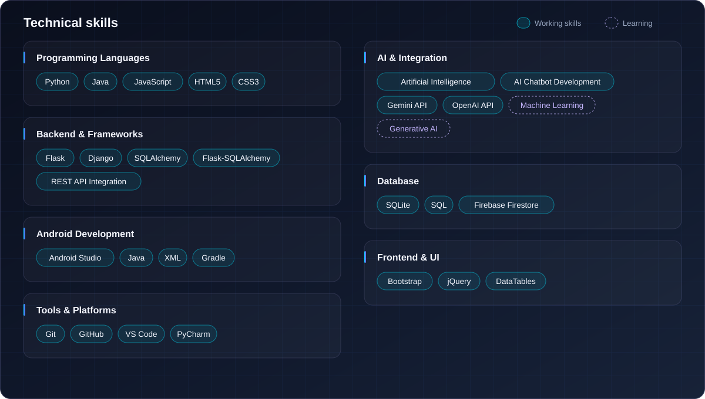
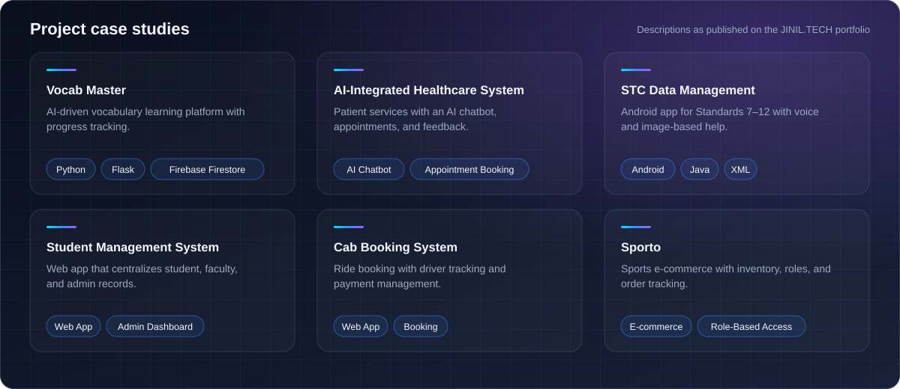

 

Hi, I’m Jinil Tailor — an AI-focused developer passionate about building intelligent applications, exploring emerging technologies, and creating practical software solutions.

## About me

- **Education:** BCA in Artificial Intelligence, Parul University, Vadodara (2022–2025, CGPA 7.49/10)
- **Focus:** practical AI and machine learning, and the Python backends that put them to use
- **Builds:** full-stack web applications and Android apps, including AI API integrations
- **Goal:** ship real-world AI-powered applications and grow into a professional AI/ML engineer

## Technical skills

## Featured projects

**[JINIL.TECH portfolio](https://github.com/CodeWithJinil/Jinil.Tech-portfolio)** — a dark, futuristic personal site with a neural-network hero, a filterable skills matrix, and project case studies. Built with plain HTML, CSS, and JavaScript.
[Source code](https://github.com/CodeWithJinil/Jinil.Tech-portfolio) · [Live site](https://jinil-portfolio-rose.vercel.app)

Full write-ups of these projects are on the [portfolio](https://jinil-portfolio-rose.vercel.app). Repository links will be added here as each project’s source is published.

## GitHub statistics

## Contribution graph

Statistics and the graph are generated live by third-party services from public GitHub data. If a card is blank, the service is temporarily unavailable.

## Currently exploring

I’m still learning these. They are not yet part of my day-to-day toolkit.

- Practical machine learning
- Generative AI and AI model integration
- AI-powered applications
- Backend architecture
- API integrations
- Modern web technologies

## Connect with me

  

